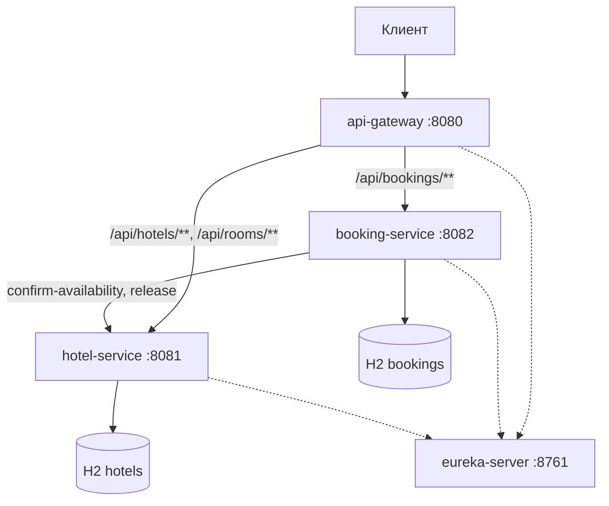

# Hotel Booking

**Итоговый проект по Spring**

Система бронирования отелей на микросервисах. Пользователь
регистрируется, ищет свободные номера и бронирует их. Номер можно выбрать самому или доверить
выбор системе. Администратор управляет отелями, номерами и пользователями, а также имеет
возможность смотреть статистику загруженности.

Проект состоит из пяти модулей:

- `eureka-server` - реестр сервисов, порт 8761
- `api-gateway` - единая точка входа на Spring Cloud Gateway, порт 8080
- `hotel-service` - отели, номера, блокировки дат и статистика, порт 8081
- `booking-service` - пользователи, выдача JWT и бронирования, порт 8082
- `common` - общий код двух сервисов (формат ошибок, проверка JWT, валидация дат).

У hotel-service и booking-service по своей базе H2 в памяти, друг с другом они общаются только
по HTTP. Клиент обращается только к шлюзу, шлюз находит адреса сервисов через Eureka, а
booking-service сам вызывает hotel-service, когда бронирует номер или снимает блокировку.
У каждого модуля есть свой README с подробностями.



Пунктиром показана регистрация в Eureka - через неё сервисы находят адреса друг друга.

Стек - Java 17, Spring Boot 3.5, Spring Cloud 2025.0, Spring Data JPA, H2, Spring Security
(OAuth2 Resource Server, JWT), Resilience4j, Micrometer Tracing, Lombok, MapStruct,
springdoc-openapi, JUnit 5, MockMvc, WireMock, Checkstyle.

## Запуск

Для запуска нужны JDK 17 или новее, а также Maven 3.9+. Больше ничего ставить не надо. 
Все библиотеки Maven скачает сам при первой сборке. В IDE должна быть включена обработка аннотаций
(в IntelliJ IDEA: Settings → Build, Execution, Deployment → Compiler → Annotation Processors),
иначе IDE не увидит код, который генерируют Lombok и MapStruct. Обычно IDEA сама предлагает её включить.

```bash
mvn clean install
```

Эта команда собирает проект и прогоняет тесты. После неё сервисы
запускаются по одному, каждый в своём терминале (или через Run Configurations в IDEA), строго
в следующем порядке:

```bash
mvn -pl eureka-server spring-boot:run
mvn -pl hotel-service spring-boot:run
mvn -pl booking-service spring-boot:run
mvn -pl api-gateway spring-boot:run
```

Когда всё поднимется, на http://localhost:8761 появятся три зарегистрированных сервиса.
Шлюз и booking-service обновляют список сервисов из Eureka раз в 30 секунд, поэтому первые
полминуты запросы через шлюз могут получать 503. Swagger UI у каждого сервиса свой -
http://localhost:8081/swagger-ui.html для отелей и http://localhost:8082/swagger-ui.html для
бронирований.

Для локального запуска настраивать ничего не нужно, но три параметра можно задать через
переменные окружения: `JWT_SECRET` (общий секрет подписи токенов, не короче 32 символов,
должен совпадать во всех сервисах), `EUREKA_URL` (по умолчанию `http://localhost:8761/eureka`)
и `SERVER_PORT`.

## Демо-данные

При каждом старте базы заполняются заново. Есть три пользователя - администратор `admin` с паролем
`admin123` и два обычных пользователя, `ivan` / `ivan123` и `maria` / `maria123`.

Отелей три - "Северная звезда" в г. Санкт-Петербурге (номера 1-5), "Волжский берег" в г. Казани
(номера 6-8) и "Горный воздух" в г. Сочи (номера 9-10). Счётчик `times_booked` у номеров специально
разный, чтобы было видно, как работает подбор. Например, в питерском отеле рекомендации идут
в порядке 3, 4, 2, 1. Номер 5 стоит на ремонте и в выдачу не попадает. Номер 1 занят бронью
Ивана с "сегодня + 5" по "сегодня + 8". На эти даты удобно проверять ответ 409. Ещё по одной
действующей брони есть на номерах 6 и 9, а у Ивана в истории лежит одна отменённая бронь.

Брони в booking-service и блокировки в hotel-service создаются с одинаковыми ключами, так что
сразу после старта данные в двух сервисах согласованы. Отключить заполнение можно настройкой
`app.seed.enabled=false`.

## Как пользоваться

Все запросы идут через шлюз `http://localhost:8080`. Сначала нужно получить токен - войти через
`POST /api/bookings/user/auth` с телом `{"username": "ivan", "password": "ivan123"}` или
зарегистрироваться через `POST /api/bookings/user/register`. Токен из ответа передаётся во всех
остальных запросах в заголовке `Authorization: Bearer <токен>` и действует один час.

Бронь создаётся запросом `POST /api/bookings/booking`:

```json
{"hotelId": 1, "startDate": "2026-12-01", "endDate": "2026-12-03", "autoSelect": true, "requestId": "my-key-1"}
```

При `autoSelect: true` система сама выберет наименее загруженный свободный номер, при `false`
нужно указать `roomId`. Поле `requestId` защищает от двойной отправки - если один и тот же запрос придёт
повторно, вернётся уже созданная бронь (код 200 вместо 201), а не новая. Поле можно не
передавать, тогда ключ сгенерирует сервис, но от повторов он уже не защитит.

Готовые запросы для всех основных сценариев (вход, бронь с автоподбором, повторная отправка,
отмена, статистика, проверка ролей) собраны в [http/demo.http](http/demo.http). Их можно
запускать прямо из IntelliJ IDEA или другой IDE от JetBrains, токены там сохраняются автоматически. У каждого запроса есть
проверка ожидаемого ответа, так что после запуска всего файла сразу видно, какие сценарии прошли.
Без IDE от JetBrains те же запросы можно отправить через Swagger UI или Postman, но без автоматических проверок.
Проверки рассчитаны на исходные демо-данные - перед повторным прогоном нужно перезапустить
hotel-service и booking-service, иначе, например, повторная регистрация того же пользователя
вернёт 409.

## Эндпойнты

Шлюз отрезает у запросов к booking-service префикс `/api/bookings` - запрос
`POST /api/bookings/booking` приходит в сервис как `POST /booking`. В Swagger booking-service
поэтому все пути без префикса.

Booking Service, без токена:

- `POST /api/bookings/user/register` - регистрация с ролью USER, сразу возвращает токен
- `POST /api/bookings/user/auth` - вход, возвращает токен.

Booking Service, для USER и ADMIN:

- `POST /api/bookings/booking` - создать бронь
- `GET /api/bookings/bookings` - история своих броней, параметры `status`, `page`, `size`
- `GET /api/bookings/booking/{id}` - своя бронь (администратор видит любую)
- `DELETE /api/bookings/booking/{id}` - отменить бронь и освободить номер
- `GET /api/bookings/booking/recommendations` - номера в порядке рекомендации, параметры
  `hotelId`, `startDate`, `endDate`.

Booking Service, только для ADMIN:

- `GET /api/bookings/user` и `GET /api/bookings/user/{id}` - пользователи
- `POST /api/bookings/user` - создать пользователя с любой ролью
- `PATCH /api/bookings/user/{id}` - изменить логин, пароль или роль
- `DELETE /api/bookings/user/{id}` - удалить пользователя, если у него нет броней

Hotel Service, для USER и ADMIN:

- `GET /api/hotels` - отели с фильтрами `city`, `name`, `minStars`, пагинацией и сортировкой
- `GET /api/hotels/{id}` - один отель
- `GET /api/rooms` - свободные номера с фильтрами `hotelId`, `city`, `type`, `minCapacity`,
  `maxPrice`, `startDate`, `endDate`, пагинацией и любой сортировкой
- `GET /api/rooms/recommend` - те же фильтры, но порядок по загруженности, параметр `limit`
- `GET /api/rooms/{id}` - один номер.

Hotel Service, только для ADMIN:

- `POST`, `PUT`, `DELETE` на `/api/hotels` и `/api/rooms` - управление отелями и номерами
- `GET /api/hotels/statistics` - сводная загруженность всех отелей, параметры `from` и `to`
- `GET /api/hotels/{id}/statistics` - загруженность одного отеля с разбивкой по номерам

Ещё у hotel-service есть два внутренних эндпойнта, `POST /api/rooms/{id}/confirm-availability`
и `POST /api/rooms/{id}/release`. Их вызывает только booking-service во время бронирования,
со специальным токеном с ролью INTERNAL. Через шлюз они не опубликованы и отвечают 404.

## Как всё устроено

**Бронирование.** Сначала booking-service сохраняет бронь в статусе `PENDING` и просит
hotel-service заблокировать номер на нужные даты. Если отель согласился, бронь становится
`CONFIRMED`. Если номер уже занят, бронь отменяется, а при автоподборе система сначала пробует
следующий подходящий номер, всего до пяти. Если отель не ответил или вернул ошибку 5xx, запрос
повторяется ещё дважды с паузами 300 и 600 мс. Если и это не помогло, бронь отменяется и в отель
уходит запрос на снятие блокировки (на случай, если она всё-таки успела создаться). Когда отель
падает часто, срабатывает CircuitBreaker, и какое-то время booking-service к нему не обращается
совсем, а сразу отвечает 503.

Если снять блокировку не удалось, например потому что отель недоступен, бронь помечается флагом
`release_pending`. Фоновая задача раз в 30 секунд повторяет снятие для таких броней. Она же
закрывает брони, которые висят в `PENDING` дольше пяти минут - так бывает, если сервис
перезапустили прямо посреди бронирования.

**Повторные запросы.** Ключ `requestId` хранится в брони с уникальным индексом и с тем же
значением передаётся в отель. Поэтому повторная отправка не создаёт вторую бронь и не занимает
номер дважды, даже если дубли приходят одновременно.

**Одновременные брони одного номера.** Перед проверкой дат hotel-service блокирует строку номера
в базе (`SELECT ... FOR UPDATE`). Из нескольких параллельных запросов на один номер и
пересекающиеся даты проходит только один, остальные получают 409.

**Подбор номера.** У каждого номера есть счётчик `times_booked` - он растёт, когда номер
бронируют, и уменьшается при отмене. При автоподборе первым предлагается номер с наименьшим
счётчиком, при равенстве с меньшим id. Так брони распределяются по номерам равномерно и
номера не простаивают. Насколько хорошо это работает, видно в статистике - там есть доля занятых ночей,
среднее число броней на номер и список номеров, которые за период ни разу не бронировали.

**Безопасность.** Токены выдаёт booking-service. Шлюз и оба сервиса проверяют подпись и срок
токена самостоятельно. Шлюз пускает без токена только регистрацию, вход и проверку
работоспособности `/actuator/health`. Роли проверяются в сервисах - правилами по адресам и
аннотациями `@PreAuthorize` на контроллерах. Без токена ответ 401, с токеном не той роли 403.

**Ошибки и логи.** Все ошибки, включая 401 и 403 и ошибки самого шлюза, приходят в одном формате:

```json
{"timestamp": "...", "status": 409, "error": "Conflict", "code": "ROOM_NOT_AVAILABLE",
 "message": "Room 1 is already booked for the requested dates", "path": "/booking", "traceId": "..."}
```

У каждого запроса есть `traceId`. Шлюз возвращает его в заголовке `X-Trace-Id`, и по нему один
и тот же запрос находится в логах всех трёх сервисов. Шаги бронирования в логах дополнительно
помечены `bookingId`. Кроме консоли сервисы пишут логи в формате JSON в папку `logs/`.

Почему выбраны именно такие решения, объяснено в [docs/adr](docs/adr). Схема баз данных с
индексами описана в [docs/database.md](docs/database.md).

## Тесты

```bash
mvn test
```

Перед запуском ничего поднимать не нужно - базы в памяти, Eureka в тестах выключена, а вместо
hotel-service для booking-service работает WireMock. Поэтому тесты не зависят от окружения.

Тесты booking-service проверяют сагу целиком - успешную бронь, отказ отеля, ошибку 500 с повторами
и компенсацией, тайм-аут, открытый CircuitBreaker и автоподбор с переходом к следующему номеру
(`BookingSagaTest`). Отдельно проверяются повторная отправка одного запроса из нескольких потоков
(`ConcurrentBookingTest`) и фоновое восстановление незавершённых броней (`SagaRecoveryTest`).
Ещё есть тесты прав доступа, пагинации истории, валидации дат и отмены (`BookingAccessTest`),
а также регистрации, входа и управления пользователями (`AuthApiTest`, `UserAdminApiTest`).

В hotel-service проверяются блокировка и снятие слота с повторными вызовами
(`AvailabilityApiTest`), параллельные попытки занять один номер (`ConcurrentHoldTest`), CRUD,
фильтры, порядок рекомендаций и статистика (`HotelApiTest`, `RoomApiTest`, `StatisticsApiTest`).
Тест шлюза (`GatewaySecurityTest`) проверяет отказ без токена, маршрутизацию, закрытые внутренние
эндпойнты и заголовок `X-Trace-Id`. Сортировка рекомендаций и расчёт загрузки покрыты обычными
unit-тестами.
