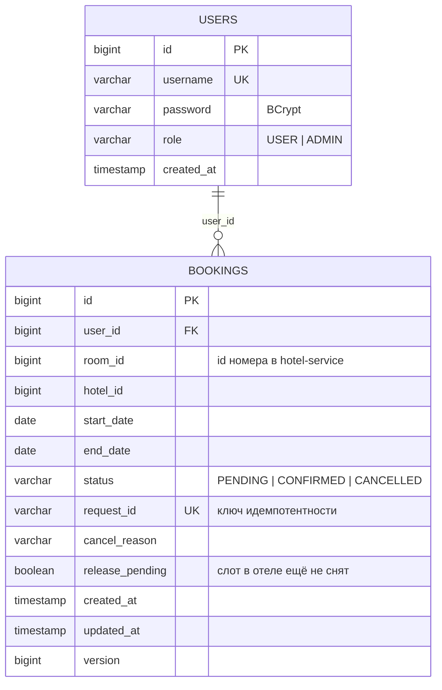
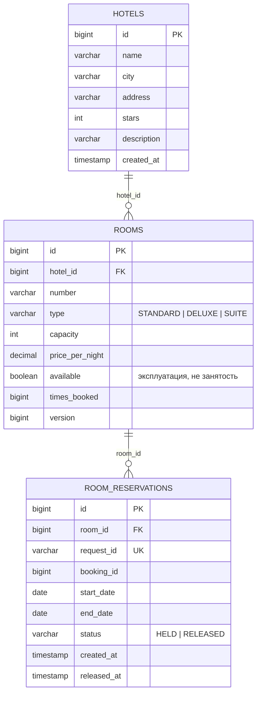

# Схема баз данных

У каждого сервиса своя in-memory база H2. Схема создаётся Hibernate по аннотациям сущностей
(`ddl-auto: create-drop`), индексы и ограничения объявлены в `@Table`. Схема для данного проекта подготовлена.
Дополнительные поля и таблицы перечислены ниже.

## booking-service (`jdbc:h2:mem:bookings`)

| Таблица | Ограничения и индексы | Зачем |
|---|---|---|
| `users` | `uk_users_username (username)` | уникальный логин |
| `bookings` | `uk_bookings_request_id (request_id)` | идемпотентность создания брони |
| | `idx_bookings_user_created (user_id, created_at)` | история пользователя с сортировкой по дате |
| | `idx_bookings_room_period (room_id, status, start_date, end_date)` | локальная проверка пересечений |
| | `idx_bookings_status_created (status, created_at)` | поиск зависших `PENDING` для `SagaRecoveryJob` |
| | `idx_bookings_release_pending (release_pending, updated_at)` | очередь повторных `release` |
| | FK `user_id -> users.id` | связь брони с пользователем |

Дополнительные поля - `hotel_id` (для истории без запроса к отелю), `request_id`, `cancel_reason`,
`release_pending` (компенсация ещё не дошла до отеля), `updated_at`, `version` (оптимистическая блокировка).

`room_id` - ссылка на сущность другого сервиса, поэтому внешнего ключа нет.

## hotel-service (`jdbc:h2:mem:hotels`)

| Таблица | Ограничения и индексы | Зачем |
|---|---|---|
| `hotels` | `uk_hotels_name_city (name, city)` | нет дублей отеля в одном городе |
| | `idx_hotels_city (city)` | фильтр по городу |
| `rooms` | `uk_rooms_hotel_number (hotel_id, number)` | номер комнаты уникален в отеле |
| | `idx_rooms_hotel (hotel_id)` | номера отеля |
| | `idx_rooms_times_booked (times_booked, id)` | сортировка рекомендаций |
| | FK `hotel_id -> hotels.id` | |
| `room_reservations` | `uk_reservations_request_id (request_id)` | идемпотентность confirm/release |
| | `idx_reservations_room_period (room_id, status, start_date, end_date)` | проверка пересечений и поиск свободных номеров |
| | `idx_reservations_booking (booking_id)` | связь с бронью для разбора инцидентов |
| | FK `room_id -> rooms.id` | |

`room_reservations` - дополнительная таблица - это и есть временная блокировка слота из шага
саги. Занятость номера по датам определяется по ней (активные записи `HELD`), а поле
`rooms.available` отражает только операционную доступность (ремонт и т.п.).

## Консистентность между базами

- Бронь `CONFIRMED` всегда имеет блокировку `HELD` с тем же `request_id`.
- Бронь `CANCELLED` после успешной компенсации не имеет активной блокировки.
- Бронь `CANCELLED` с `release_pending = true` может ещё держать блокировку; `SagaRecoveryJob`
  повторяет `release`, пока отель его не примет.
